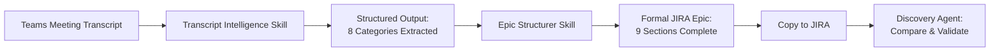

# Epic Structurer - Quick Reference

## 🎯 Purpose
Convert structured discovery data into formal JIRA epics with **measurable** acceptance criteria.

---

## 📋 Required Inputs

### From Transcript Intelligence
- Business objectives (problems + goals + success criteria)
- User roles/personas (job functions + pain points)
- KPIs & success metrics (targets + measurement methods)
- Assumptions & constraints
- Dependencies & risks
- Unresolved decisions

### Additional Context Needed
- Epic ID from JIRA (if exists)
- Project/team ownership
- Strategic alignment (company goals/OKRs)
- Timeline/milestone targets
- Budget/resource constraints

---

## 📝 9 Mandatory Epic Sections

| # | Section | Key Requirement | Example Output |
|---|---------|----------------|----------------|
| **1** | Epic Title | Format: `[Capability]: [User Outcome]` | ✅ "Customer Sentiment Analysis: Real-Time Risk Detection" |
| **2** | Business Objective | Problem + Target Outcome + Measurable Value (with $$ or %) | ✅ "Reduce churn by 15% through early intervention in negative sentiment interactions (estimated $2M annual revenue retention)" |
| **3** | User Personas | Primary/Secondary personas with quantified pain points, goals, success metrics | ✅ Supervisor: "Identify negative sentiment within 10 seconds (from current 'never in real-time')" |
| **4** | Success Metrics | Table with: Target, Baseline, Measurement Method, Frequency, Owner, Success Threshold | ✅ "P95 latency < 2 seconds; measured via APM; real-time monitoring; 95% over 7 days" |
| **5** | In Scope | Specific capabilities grouped by category (Core, UX, Technical, Data, Compliance) + MVP deliverables | ✅ "Real-time sentiment analysis for chat interactions (MVP - voice in Phase 2)" |
| **6** | Out of Scope | What's excluded + **Rationale** explaining WHY not included | ✅ "Voice analysis - Rationale: Transcription latency adds 3-5s, degrading UX target" |
| **7** | Dependencies | Critical path (BLOCKERS) + Important + External; with ETA, Impact, Mitigation | ✅ "Data pipeline v3.2 - ETA March 15 - If blocked: 6-8 week delay - Mitigation: Weekly sync with owner" |
| **8** | Risks | Critical/High/Medium/Low with Impact, Probability, Mitigation, Contingency Plan | ✅ "Accuracy <85% - Impact: Cannot launch - Mitigation: POC in Sprint 1 - Contingency: Switch to Azure API" |
| **9** | Acceptance Criteria | **MEASURABLE ONLY** - Given/When/Then + Verification Method + Success Threshold + Links to KPI | ✅ "P95 latency < 2 seconds; verified by load test 1000 msg; success = 95% under 2000ms" |

---

## ❌ BANNED Terms (Use These = NOT READY)

### Vague Acceptance Criteria Terms
Never use these WITHOUT quantification:
- "fast", "quick", "slow"
- "intuitive", "easy to use", "user-friendly"
- "robust", "reliable", "high quality"
- "scalable", "performant", "efficient"
- "secure", "compliant", "accessible"
- "most", "majority", "significant", "minimal", "reasonable"
- "improved", "better", "enhanced", "optimized"

### Replace With
✅ Instead of "fast" → "P95 latency < 2 seconds"
✅ Instead of "user-friendly" → "80% of users complete task without help in usability test"
✅ Instead of "scalable" → "Handles 1000 concurrent sessions with P95 latency < 2s"
✅ Instead of "most" → "75% of supervisors" or "80% of cases"
✅ Instead of "improved" → "+15% reduction" or "from 72 to 82 CSAT"

---

## 🎯 Acceptance Criteria Template

```markdown
#### [Number]. [Feature Name]
**Given** [initial state with specific context]  
**When** [specific action or trigger with quantified input]  
**Then** [measurable outcome with numbers, percentages, or observable state]

**Verification Method:**
- [How will this be tested? Automated test? Manual test? User study?]
- [Specific test steps, sample size, measurement tools]

**Success Threshold:**
- [Exact number, percentage, or pass/fail criteria]
- [Must be binary: pass or fail, no ambiguity]

**Links to Success Metric:** "[KPI Name]" (target value)
```

---

## 📊 Success Metrics Table Format

```markdown
| Metric Name | Target | Baseline | Measurement Method | Measurement Frequency | Owner | Success Threshold |
|-------------|--------|----------|-------------------|----------------------|-------|-------------------|
| [Metric] | [Number with unit] | [Current state] | [How measured + tool] | [When measured] | [Person name] | [Pass criteria + duration] |
```

**Example:**
| Metric Name | Target | Baseline | Measurement Method | Frequency | Owner | Success Threshold |
|-------------|--------|----------|-------------------|-----------|-------|-------------------|
| Real-time Processing Latency | P95 < 2 seconds | N/A (new feature) | P95 latency via Datadog APM | Real-time monitoring | Emily Zhang | 95% under 2s over 7 consecutive days |

---

## 🚦 Quality Gates (Must Pass Before "Ready")

### Section-Level Quality Checks

✅ **Business Objective**
- [ ] Problem statement is specific (not generic)
- [ ] Target outcome includes measurable impact (with numbers)
- [ ] Business value quantified ($$, %, time saved)
- [ ] Strategic alignment documented (company goals)

✅ **User Personas**
- [ ] At least 1 primary persona defined
- [ ] Pain points have quantified impact (time, cost, frequency)
- [ ] Goals have measurable success criteria
- [ ] "Success looks like" describes observable outcome

✅ **Success Metrics**
- [ ] 5-10 metrics defined (not too few, not overwhelming)
- [ ] All 7 columns filled for each metric (Target, Baseline, Method, Frequency, Owner, Threshold)
- [ ] Mix of leading (early signals) and lagging (final outcomes) indicators
- [ ] Measurement methods are specific and repeatable

✅ **In Scope / Out of Scope**
- [ ] In scope is specific (not vague like "improve UX")
- [ ] Out of scope includes **rationale** for each exclusion
- [ ] MVP deliverables clearly marked with ✅
- [ ] Post-MVP enhancements marked with 📅 and target phase

✅ **Dependencies**
- [ ] Critical blockers identified with RED flag
- [ ] All dependencies have: Status, ETA, Impact, Mitigation
- [ ] Dependency owners named (person, not team)
- [ ] Tracking/review frequency defined

✅ **Risks**
- [ ] At least 3-5 risks identified (not exhaustive, but realistic)
- [ ] Each risk has: Impact level, Probability %, Mitigation strategy, Contingency plan
- [ ] Critical/High risks have active owners and review cadence
- [ ] Risk management plan includes escalation triggers

✅ **Acceptance Criteria** (CRITICAL)
- [ ] Zero vague terms without quantification
- [ ] All AC follow Given/When/Then format
- [ ] Verification method is testable (automated or manual with clear steps)
- [ ] Success threshold is binary (pass/fail, no ambiguity)
- [ ] Links back to at least one Success Metric KPI

### Epic-Level Quality Checks

✅ **Overall Completeness**
- [ ] All 9 sections present and complete (no placeholders or TBDs)
- [ ] Consistent language and terminology throughout
- [ ] No contradictions between sections (e.g., scope vs AC)
- [ ] Definition of Done includes all categories (Functional, Non-Functional, Quality, Operational, Business)

✅ **Measurability**
- [ ] Every goal, requirement, and AC can be verified
- [ ] Success can be objectively determined (not subjective)
- [ ] Acceptance criteria are testable in staging/production

✅ **Stakeholder Alignment**
- [ ] All key stakeholders identified with contact info
- [ ] Decision makers defined for key decisions
- [ ] Review/approval process documented

---

## ⚡ Quick Start Workflow

### Step 1: Gather Inputs
```markdown
**Run Transcript Intelligence first** if you have meeting transcripts or unstructured notes.

Inputs needed:
- Extracted business objectives (problems + goals)
- Extracted KPIs (targets + measurement methods)
- Extracted user roles & pain points
- Extracted dependencies & risks
- Extracted assumptions & constraints
- Epic ID (if updating existing), Project/Team, Strategic context
```

### Step 2: Structure Epic Sections 1-3 (Foundation)
```markdown
1. **Epic Title:** [Capability]: [User Outcome]
2. **Business Objective:** Problem → Outcome → Value (with $$)
3. **User Personas:** Primary + Secondary with quantified goals
```

### Step 3: Define Success (Sections 4 & 9)
```markdown
4. **Success Metrics Table:** 5-10 KPIs with all 7 columns
9. **Acceptance Criteria:** Given/When/Then with measurable thresholds
   - Link each AC to a Success Metric
```

### Step 4: Scope & Boundaries (Sections 5-6)
```markdown
5. **In Scope:** Core capabilities + MVP deliverables (✅)
6. **Out of Scope:** Excluded items + Rationale for each
```

### Step 5: Risk Management (Sections 7-8)
```markdown
7. **Dependencies:** Critical path (BLOCKERS) with mitigation
8. **Risks:** Critical/High risks with contingency plans
```

### Step 6: Quality Check
```markdown
Run through quality gates checklist:
- All 9 sections complete?
- Zero vague AC terms?
- All metrics measurable and testable?
- Dependencies have owners and ETAs?
- Risks have mitigation + contingency?
```

### Step 7: Finalize & Publish
```markdown
Add:
- Definition of Done (Functional, Non-Functional, Quality, Operational, Business)
- Team & Stakeholders list
- Timeline & Milestones
- Related Documentation links
- Epic Health Dashboard
```

---

## 💡 Pro Tips

### Writing Measurable Acceptance Criteria
1. **Start with the measurement:** What number/percentage defines success?
2. **Work backwards to "then" statement:** The outcome must yield that measurement
3. **Define test conditions:** How will you verify this in staging/production?
4. **Link to KPI:** Every AC should support at least one Success Metric

### Example Process
```markdown
❌ BAD (Vague):
"System should be fast and responsive"

🔄 IDENTIFY THE MEASUREMENT:
What is "fast"? → P95 latency < 2 seconds

✅ GOOD (Measurable):
**Given** an active chat interaction
**When** customer sends a message
**Then** sentiment score displays on agent dashboard within 2 seconds for 95% of messages

**Verification Method:** Load test 1000 messages; measure P95 latency via APM
**Success Threshold:** P95 < 2000ms over 7 consecutive days
**Links to Success Metric:** "Real-time Processing Latency" KPI
```

### Avoiding Scope Creep
- **Out of Scope is as important as In Scope** - document what's NOT included
- **Always include rationale** - explain WHY something is deferred/excluded
- **Use phase markers** - MVP (Phase 1) vs Future Enhancements (Phase 2/3/4)
- **Reference separate epics** - "See EPIC-XYZ for voice sentiment analysis"

### Managing Dependencies
- **Name people, not teams** - "John Smith (Data Platform PM)" not "Data Platform Team"
- **Status updates are mandatory** - Owner provides weekly update or delegates
- **Escalation triggers predefined** - "If slips >1 week, escalate to Director"
- **Mitigation is realistic** - "Switch to Azure API (2-week delay, already POC'd)" not "TBD"

### Risk Management
- **Contingency plans are mandatory for Critical/High risks** - What WILL you do if it happens?
- **Probability is data-driven** - Base on past experience, vendor SLAs, team velocity
- **Impact is business-focused** - "Cannot launch" or "$2M ROI at risk" not "might be an issue"
- **Review cadence matches risk level** - Critical = weekly, High = bi-weekly, Medium = monthly

---

## 🔗 Integration with Other Skills

### Workflow: Discovery → Extraction → Structuring → JIRA



### Conversation Extractor → Epic Structurer Mapping

| Conversation Extractor Output | Epic Structurer Input Section |
|------------------------------|-------------------------------|
| Business Objectives (Problems + Goals) | Business Objective (Problem Statement + Target Outcome) |
| KPIs (Metrics with targets) | Success Metrics Table |
| User Roles (Personas) | User Personas (with quantified pain points + goals) |
| Assumptions | Business Objective (Strategic Alignment), User Personas (Context) |
| Risks (with severity + mitigation) | Risks (Critical/High/Medium/Low with contingency) |
| Dependencies (with critical path) | Dependencies (Critical Path BLOCKERS + Important) |
| Unresolved Decisions | Risks (decisions that create uncertainty), Out of Scope (deferred decisions) |
| Technical Constraints | In Scope (Technical Implementation), Out of Scope (limitations with rationale) |

---

## 📚 See Also

- **[Epic Structurer Skill (Full)](epic-structurer-skill.md)** - Complete skill definition with all templates
- **[Example Epic Structurer Output](example-epic-structurer-output.md)** - Full example of "Customer Sentiment Analysis" epic
- **[Transcript Intelligence Skill](transcript-intelligence-skill.md)** - Extract structured data from meeting notes
- **[Example Extraction Output](example-extraction-output.md)** - Extracted data from sample discovery meeting
- **[Discovery Agent](../agents/Jinks/discovery-agent.md)** - Full workflow for transcript → JIRA comparison

---

## ⚠️ Common Mistakes to Avoid

### ❌ Mistake 1: Vague Acceptance Criteria
```markdown
❌ "System should be user-friendly and intuitive"
✅ "80% of new users complete first task without help in usability test"
```

### ❌ Mistake 2: Missing Rationale in Out of Scope
```markdown
❌ "Voice sentiment analysis - Out of scope"
✅ "Voice sentiment analysis - Rationale: Transcription latency adds 3-5s, degrading UX. Deferred to Phase 2."
```

### ❌ Mistake 3: Unmeasurable Success Metrics
```markdown
❌ Target: "Improve CSAT significantly"
✅ Target: "+10 points CSAT (from 72 to 82) sustained for 2 consecutive months"
```

### ❌ Mistake 4: Dependencies Without Owners
```markdown
❌ "Depends on Data Platform Team completing pipeline"
✅ "Depends on John Smith (Data Platform PM) completing pipeline (EPIC-789, ETA March 15)"
```

### ❌ Mistake 5: Risks Without Contingency Plans
```markdown
❌ "Risk: AWS API may be inaccurate. Mitigation: Test thoroughly."
✅ "Risk: Accuracy <85%. Mitigation: POC in Sprint 1. Contingency: Switch to Azure API (2-week delay, already POC'd)"
```

### ❌ Mistake 6: Acceptance Criteria Not Linked to KPIs
```markdown
❌ AC: "Sentiment displays in real-time" (no verification or threshold)
✅ AC: "Sentiment displays within 2s for 95% of messages. Verification: Load test. Links to 'Real-time Latency' KPI."
```

---

## 🎓 Training Resources

### Quick Reference Cards
- **[Measurable AC Cheat Sheet](link-to-doc)** - Examples of good vs bad AC
- **[Banned Terms List](link-to-doc)** - Printable checklist of vague words to avoid
- **[Success Metrics Template](link-to-template)** - Copy/paste table format

### Video Tutorials
- **[Epic Structurer Walkthrough (15 min)](link-to-video)** - Complete epic structuring demo
- **[Writing Measurable AC (8 min)](link-to-video)** - Focus on acceptance criteria best practices
- **[Quality Gates Review (5 min)](link-to-video)** - How to validate epic readiness

### Templates & Examples
- **[Blank Epic Template](link-to-template)** - Starter template with all 9 sections
- **[Example Epic Library](link-to-library)** - 5+ complete epic examples across domains
- **[Common Patterns Guide](link-to-guide)** - Reusable patterns for common epic types

---

**Last Updated:** March 6, 2026  
**Maintained By:** Product Excellence Team  
**Questions?** [Slack: #epic-structurer-skill](slack://channel/epic-structurer-skill)
